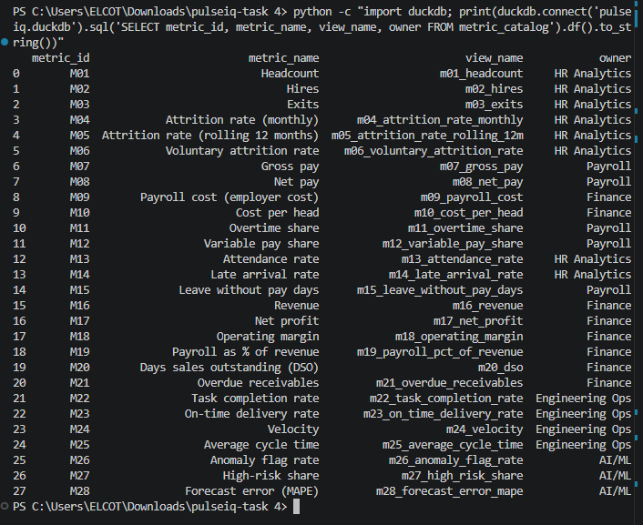
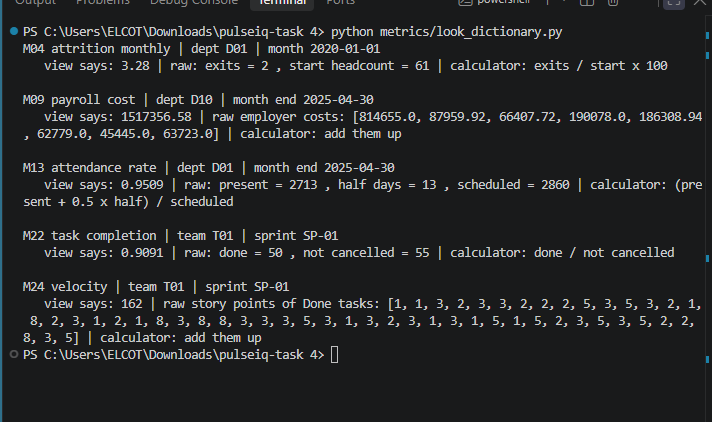

# Task 4: Governed Metric Layer

## What I built
- 28 metric views, one per metric in metric_dictionary, named m01_... to m28_...
- A metric_catalog view listing each metric, definition, formula, source, grain, owner and view name
- All 28 views return data (M28 returns rows but is awaiting actuals, see below)

## Small-group privacy rule
Each view hides groups smaller than the minimum group size in the dictionary
(5 employees, 10 employees for attrition and high-risk share, 5 tasks for task metrics).
Employee-level metrics (M07, M08, M09, M15) are shown by department x month, so no
single person's pay is displayed.

## Attrition decision
Last 12 months: 57 exits.
| Denominator | Headcount | Attrition |
| Start | 394 | 14.47% |
| End | 441 | 12.93% |
| Average | 410.8 | 13.88% |
I chose the average headcount for the 12-month rate, because headcount grew during the
year. Start overstates attrition and end understates it. Monthly attrition (M04) uses
start headcount, as in the dictionary.

## Hand-checks
| Metric | Calculation | My calculator | View value | Equal? |
|---|---|---|---|---|
| M04 attrition monthly, D01, Jan 2020 | 2 / 61 x 100 | 3.28 | 3.28 | Yes |
| M09 payroll cost, D10, Apr 2025 | sum of 8 employer costs | 1,517,356.58 | 1,517,356.58 | Yes |
| M13 attendance rate, D01, Apr 2025 | (2713 + 0.5 x 13) / 2860 | 0.9509 | 0.9509 | Yes |
| M22 task completion, T01, SP-01 | 50 / 55 | 0.9091 | 0.9091 | Yes |
| M24 velocity, T01, SP-01 | sum of 50 story points | 162 | 162 | Yes |

## Known notes
- M28 is "awaiting actuals": forecasts start Oct 2026 and actual headcount ends Sep 2026.
- Duplicate payroll rows found in Task 3 (check C03) are still in the payroll metrics.
- 
- 