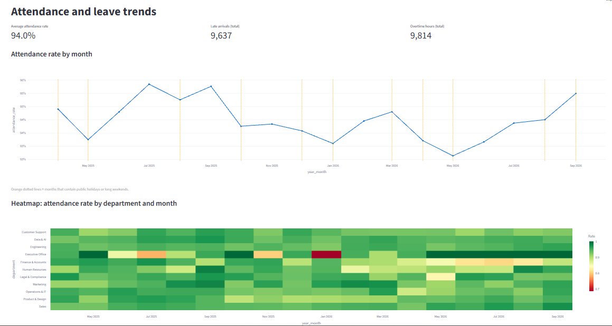
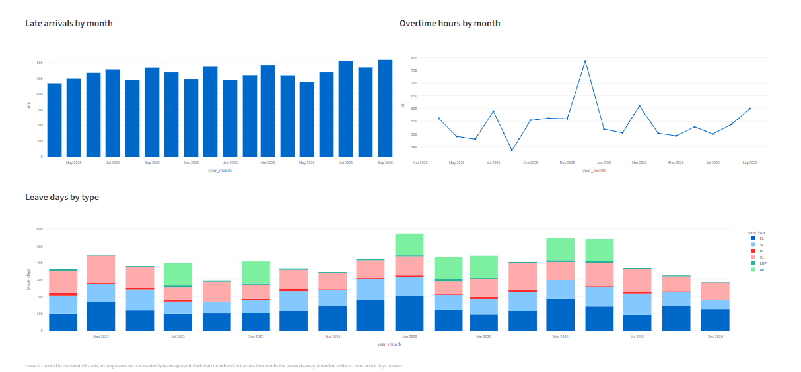
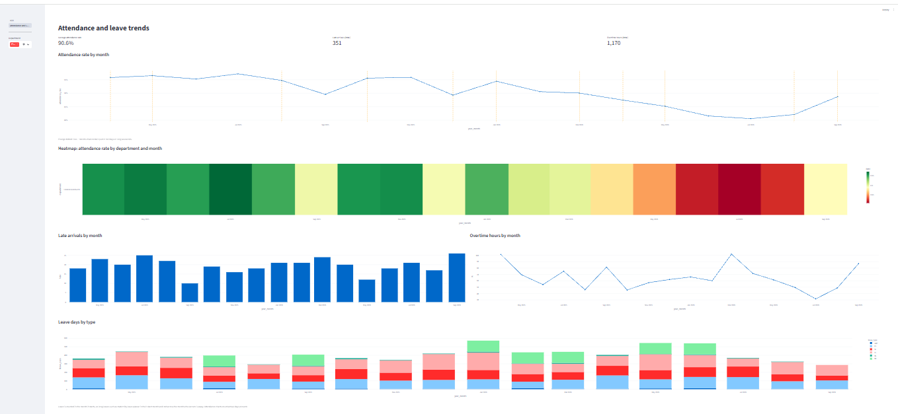

# Task 6: Attendance and leave trends

**Page:** `pages/2_Attendance_and_Leave.py` (part of the PulseIQ dashboard)
**Period:** Apr 2025 to Sep 2026 (18 months)
**Data:** `fact_attendance_monthly`, `fact_leave`, `dim_date` (schema `dw`)

## Screenshots

## How the page is built

- **Attendance rate** = total present days / total scheduled days (a ratio of sums, not an average of rates). Scheduled days are the working-day denominator.
- **Late arrivals** and **overtime hours** are shown by month, with a rate per 100 scheduled days used when comparing months of different size.
- **Leave days by type** come from `fact_leave`, counted in the month the leave starts.
- **Holidays** from `dim_date` are marked with orange dotted lines, so a dip can be checked against the calendar first.
- **Department filter** in the sidebar changes the attendance line, heatmap, late arrivals and overtime. Leave is company-wide on the chart.
- Views: `dw.v_attendance_monthly`, `dw.v_leave_monthly`, `dw.v_holidays_monthly` (see `sql/attendance_views.sql`).

## Three unusual months

| Month | What happened | Likely cause |
|---|---|---|
| Jan 2026 | Leave peaked at 573 days, 40% above the 408-day monthly average. Company attendance 93.1%. | 3 holidays (Thu 1 Jan, Wed 14 Jan, Mon 26 Jan), so people likely extended them with leave. |
| May 2026 | Lowest company attendance: 92.6% vs 94.0% average (z-score -1.75, a mild signal). Leave 545 days, 34% above average. | Fri 1 May makes a long weekend, and a long maternity leave started in Finance on 13 May. May 2025 was also low (93.2%), so part of the dip looks seasonal. |
| Dec 2025 | Overtime reached 787 hours vs a 545-hour average, about 44% higher and the largest spike in 18 months. | Year-end workload is the likely cause. The data does not show which department drove it, so this is a guess. |

**Not counted as an unusual month:** Executive Office fell to 68.4% in Jan 2026, but on only 19 scheduled days (about one person's month). That is noise from a small group, not a finding.

## Three insights

1. **Finance & Accounts attendance fell from 97.2% (Jul 2025) to 80.6% (Jul 2026)** while the company held at 93.9%. Paid leave rose from 5 to 61 days. Two approved maternity leaves of 130 working days each (13 Mar to 10 Sep and 13 May to 10 Nov 2026) explain most of the rise, roughly 44 of the 61 days in Jun to Aug. Unpaid absence stayed near 4 days and late arrivals stayed flat, so this is planned leave and not an engagement problem. Attendance recovered to 88.7% in Sep 2026 as the first leave ended.
2. **Leave peaks in Jan 2026 (573 days) and May 2026 (545 days), 34 to 40% above the 408-day average,** and both months contain a Monday or Friday holiday, which fits long-weekend bridging.
3. **Late arrivals are steady at 5.8 to 7.1 per 100 scheduled days.** The raw count rose from 468 (Apr 2025) to 618 (Sep 2026), but scheduled days grew too, so the rate shows no real worsening. A rate is the fair measure here, not a count.

## Which department would I check first after a dip?

I would check the department that changed most against its own normal level, before the biggest department. The biggest department moves the company total just because of its size, so it can look like the cause when nothing unusual happened there. In this data the company line barely moved in 2026, while Finance & Accounts dropped about 16 points from its own July 2025 level. The company average hid it. After finding the department, I would look at the cause in the data before drawing a conclusion: here it turned out to be two long leaves in a team of about 16 people, not a morale problem. I would then check the biggest department as a second step, to confirm it is not following the same pattern.

## Limits

- Executive Office has about 20 scheduled days a month, so its rate is unreliable. It is exactly 100% from May to Sep 2026, which looks like generated data.
- A company z-score of -1.75 for May 2026 is mild.
- Leave is counted in the month it starts, so long leaves appear in their start month and not across the months the person is away. Attendance counts actual days present, so the two charts do not line up month by month.
- Leave on the chart is company-wide. The Finance leave split was done by linking employees to their department.
- The cause of the Dec 2025 overtime spike is a guess, not shown in the data.
- The data is synthetic and some patterns may come from how it was generated.

## Link to the next task

Attendance shows when people are present. Task 7 asks who leaves and why. The Finance dip here is planned maternity leave, so it is not treated as an attrition signal.