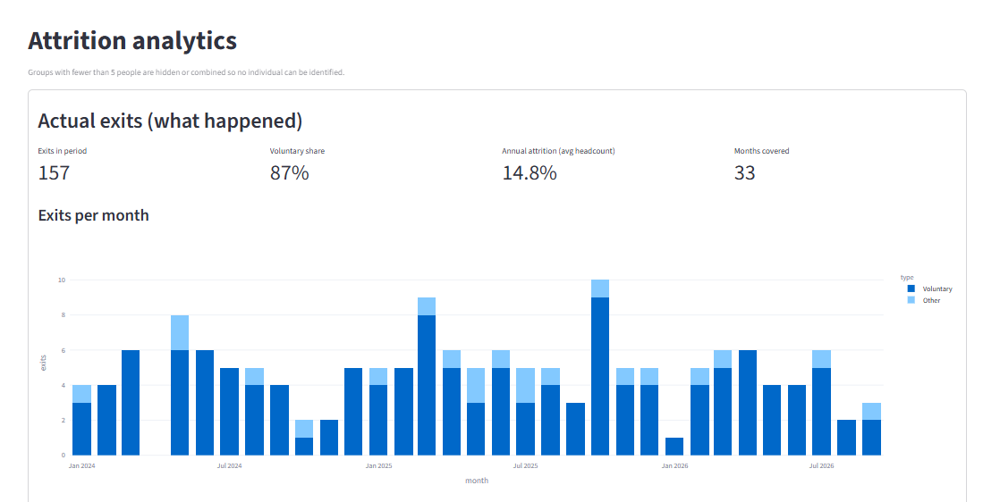
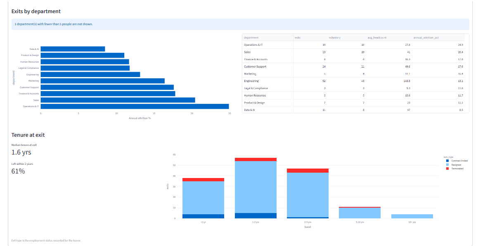
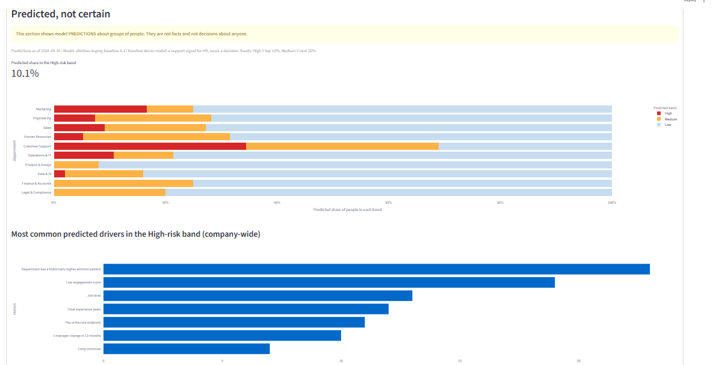
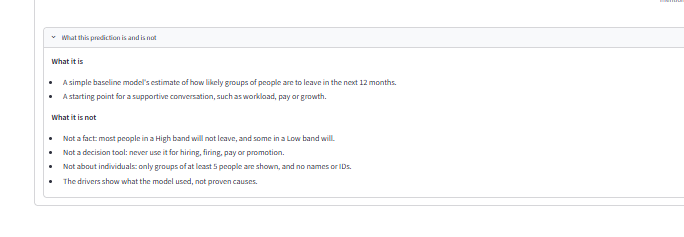
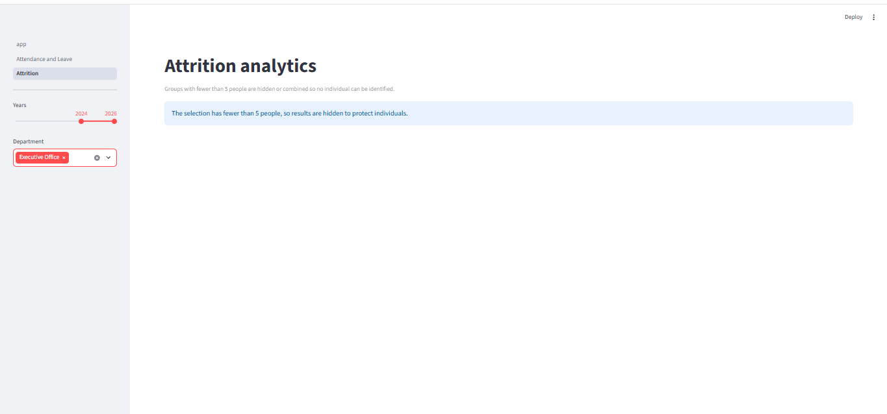

# Task 7: Attrition analytics

**Page:** `pages/3_Attrition.py` (part of the PulseIQ dashboard)
**Period shown:** Jan 2024 to Sep 2026 (33 months)
**Data:** `fact_headcount_monthly`, `dim_employee` (used only in grouped form), `fact_attrition_risk` (used only in grouped form)
**Views:** `dw.v_exits_monthly`, `dw.v_exit_tenure`, `dw.v_risk_by_dept`, `dw.v_risk_reasons` (see `sql/attrition_views.sql`)

## Screenshots

## How the page is built

- **Actual exits** section: exits per month (voluntary vs other), exits and annual attrition by department, tenure at exit with exit type.
- **Predicted, not certain** section: separate box with a warning banner, model name and note, predicted risk by department (never by person), common predicted drivers, and a note on what the prediction is and is not.
- **Annual attrition** = exits x 12 / sum of monthly average headcount (average headcount denominator, as chosen in Task 4).
- **Minimum group size rule:** groups under 5 people are hidden or combined, so no individual can be identified.
- **Privacy guard:** if the selected departments together have fewer than 5 people (for example only the Executive Office), the page shows a message and hides all results.
- Filters: years slider and department list in the sidebar.

## Three findings (actual exits)

1. **Attrition ran at 14.8% a year** from Jan 2024 to Sep 2026: 157 exits, of which about 136 (87%) were voluntary. The official 12-month rate to Sep 2026 is 13.88% (`v5_company_attrition_12m`). 2025 was the busiest year with 69 exits (2024: 51), and 2026 is lower so far with 37 exits in 9 months.
2. **Operations & IT loses people fastest: 24.9% a year over the period** (19 exits on about 28 people) and 26.6% in the last 12 months, roughly three times Data & AI (8.5%). Its voluntary rate in the last 12 months was 22.78%. Engineering has the most exits (52), but its rate is 13.1%, close to the company average. Counts and rates give different answers, so I compare rates.
3. **People leave early.** Median tenure at exit is 1.6 years and 61% leave within 2 years, and the 1-2 year band is the largest. Across the full history (304 exits), 267 (88%) were resignations, 24 were terminations and 13 were contracts ending, so most exits are the employee's choice.

## Predicted, not certain (kept separate from the findings above)

- The model places 43 of 425 scored people (10.1%) in the High band, 86 (20.2%) in Medium and 296 in Low. This is **by design**: the model note says High is the top 10% and Medium the next 20%, so the company-wide High share says nothing about real risk. Only the differences between departments carry information.
- **Customer Support has the highest predicted High share (34.5% of 58 scored people).** Its actual attrition was 17.6% a year over Jan 2024 to Sep 2026, above the company's 14.8%, but only 5.7% in the last 12 months (3 exits). The prediction looks 12 months ahead from Sep 2026, so it cannot be checked against past exits yet. Operations & IT has the highest actual rate but only the third-highest predicted share (10.7%), so the model and the history do not rank departments the same way. I treat the prediction as a prompt to talk to teams, not as a result.
- The most common predicted driver is "department has a historically higher attrition pattern" (23 mentions), then low engagement score (19), job level (13), total experience (12) and pay against role midpoint (11). The first driver partly repeats department history, so it should not be read as a new cause.

## Do my numbers match the metric views?

- Exits Jan 2024 to Sep 2026: page = `m03_exits` = 157 (exact match).
- Voluntary 12-month rate for Operations & IT (Sep 2026): page = `m06_voluntary_attrition_rate` = 22.78% (exact match).
- 12-month company attrition to Sep 2026: page 13.94% vs `v5_company_attrition_12m` 13.88%. The 0.06-point gap comes from how average headcount is calculated. The metric view is the official figure and uses the average-headcount denominator I chose in Task 4.
- Exits in the headcount table (304) equal leavers in `dim_employee` (304), and voluntary exits (267) equal the Resigned count (267).

## What the prediction is and is not

- **It is** a baseline model's estimate of how likely groups of people are to leave in the next 12 months, and a reason to start a supportive conversation about workload, pay or growth.
- **It is not** a fact (most people in a High band will not leave, and some in a Low band will), a decision tool for hiring, firing, pay or promotion, or information about any individual.
- Only groups of at least 5 people are shown, with no names or IDs.
- The drivers show what the model used, not proven causes.
- Model: `attrition-logreg-baseline-0.1`, described in its own note as "a support signal for HR, never a decision".

## A department has only 4 people: what do I show, and why?

If a department has only 4 people, I would not show its attrition rate, risk level or reasons. With 4 people, one person leaving looks like 25% attrition, and one "High risk" label points to one person, so people who know the team could guess who it is. My page hides any group with fewer than 5 people and shows a message instead. If several small departments together reach 5 people, the page shows them as one combined group.

The screenshot below shows the page with only the Executive Office selected: the results are hidden.

## Limits

- The model is a baseline demo, and its top driver partly repeats department history.
- For groups of 10 to 20 scored people, the High share rests on one to three people (Marketing's 16.7% of 12 people is 2 people), so treat it as a rough signal.
- Rates in small departments swing a lot: Product & Design had 6 exits on about 25 people in the last 12 months (23.7%) against 11.1% over the whole period.
- "Voluntary" in the exits chart comes from the headcount table and "Resigned" in the tenure chart from the employee record. They agree in total (267) but come from different columns.
- The Executive Office (fewer than 5 people) is not shown.
- The data is synthetic.

## Link to the next task

Attrition describes who leaves. Task 8 looks at how teams work.