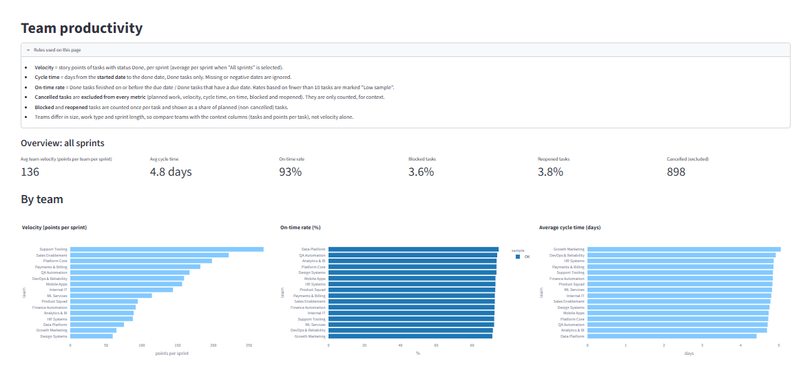
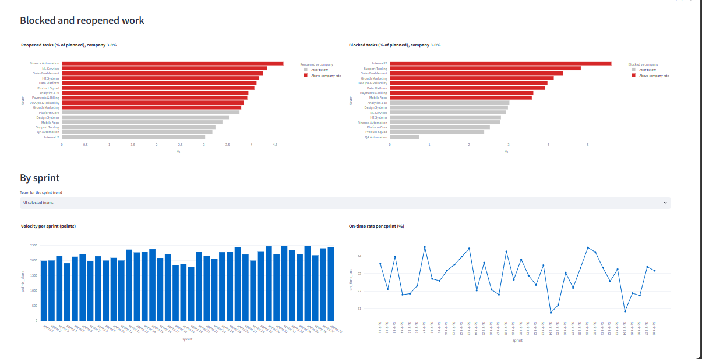
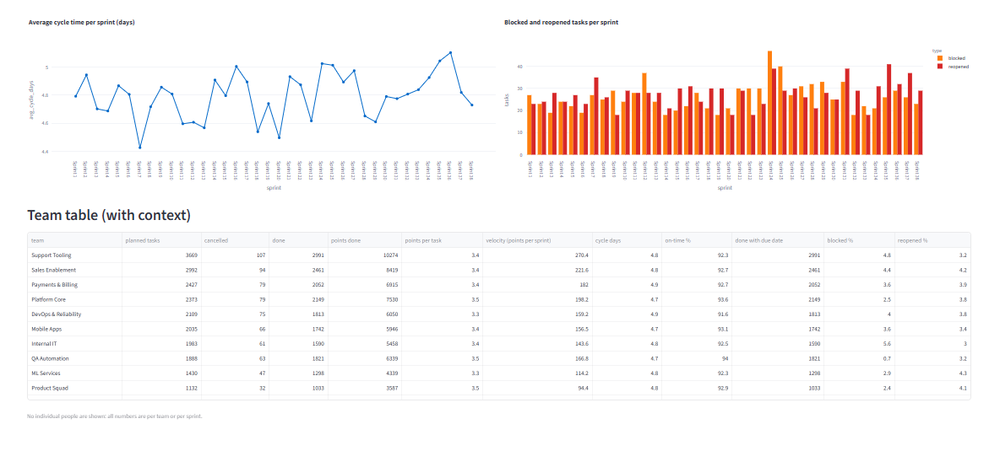
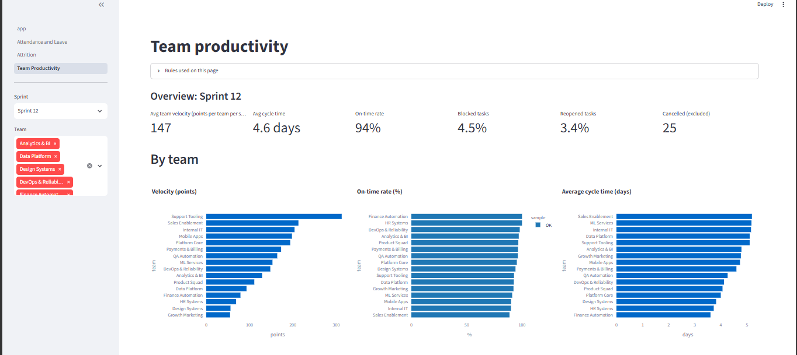

# Task 8: Team productivity dashboard

**Page:** `pages/4_Team_Productivity.py` (part of the PulseIQ dashboard)
**Data:** `fact_task`, `dim_team`, `dim_sprint` (16 teams, 38 sprints)
**Views:** `dw.v_task_clean`, `dw.v_task_metrics`, `dw.v_team_sprint`, `dw.v_team_overall`, `dw.v8_velocity`, `dw.v8_cycle_time`, `dw.v8_on_time_rate` (see `sql/team_views.sql`)
**Metric rules:** see `reports/metric_definitions.md`

## Screenshots

## Rules (also shown on the page)

- **Velocity** = story points of tasks with status Done, per sprint. On the page, "average team velocity" is points per team per sprint.
- **Cycle time** = days from the started date to the done date, Done tasks only. Missing or negative dates are ignored.
- **On-time rate** = Done tasks finished on or before the due date / Done tasks that have a due date.
- **Cancelled tasks** are excluded from every metric (planned work, velocity, cycle time, on-time, blocked and reopened) and only counted for context. Cancelled work was never delivered, so counting it would lower velocity and on-time unfairly, and it would hide how much work was really planned.
- **Reopened** = a task with at least one reopen (`reopened_count` above 0), counted once per task.
- **Blocked** = a task whose status is Blocked. Both are shown as a share of planned (non-cancelled) tasks.

## Company totals (all 38 sprints)

| Measure | Value |
|---|---|
| Planned tasks (cancelled excluded) | 27,950 |
| Cancelled tasks (excluded) | 898 |
| Done tasks | 24,119 |
| Velocity | 2,173.5 points per sprint (about 136 per team per sprint) |
| Average cycle time | 4.8 days |
| On-time rate | 92.9% |
| Blocked share | 3.6% |
| Reopened share | 3.8% |

## Verification (2 teams checked against the raw rows)

I recalculated every number for Support Tooling (the largest team) and ML Services (a mid-sized team) straight from the raw `fact_task` rows with separate pandas code, then compared with the metric views. All 18 numbers match.

| team | metric | by hand (raw rows) | metric view | match |
|---|---|---|---|---|
| Support Tooling | planned tasks | 3669 | 3669 | YES |
| Support Tooling | cancelled tasks | 107 | 107 | YES |
| Support Tooling | done tasks | 2991 | 2991 | YES |
| Support Tooling | points done | 10274 | 10274 | YES |
| Support Tooling | sprints with work | 38 | 38 | YES |
| Support Tooling | avg cycle days | 4.85 | 4.85 | YES |
| Support Tooling | on-time % | 92.34 | 92.34 | YES |
| Support Tooling | blocked tasks | 177 | 177 | YES |
| Support Tooling | reopened tasks | 119 | 119 | YES |
| ML Services | planned tasks | 1430 | 1430 | YES |
| ML Services | cancelled tasks | 47 | 47 | YES |
| ML Services | done tasks | 1298 | 1298 | YES |
| ML Services | points done | 4339 | 4339 | YES |
| ML Services | sprints with work | 38 | 38 | YES |
| ML Services | avg cycle days | 4.83 | 4.83 | YES |
| ML Services | on-time % | 92.30 | 92.30 | YES |
| ML Services | blocked tasks | 42 | 42 | YES |
| ML Services | reopened tasks | 62 | 62 | YES |

I also re-added the Done tasks and story points from `reports/verify_rows_Support_Tooling.csv` and `reports/verify_rows_ML_Services.csv`: 2,991 tasks and 10,274 points for Support Tooling, 1,298 tasks and 4,339 points for ML Services.

## Three findings

1. **Velocity mostly shows team size, not quality.** Support Tooling delivers 270.4 points per sprint and Design Systems 59.4, a 4.6x gap, while their planned tasks differ 5.0x (3,669 vs 737). Across all 16 teams, points per task stay between 3.2 and 3.6, cycle time between 4.4 and 5.1 days, and on-time between 91.3% and 94.8%. Ranking teams by velocity alone would mainly rank their size.
2. **Teams differ in blocked and reopened work.** The company rates are 3.6% blocked and 3.8% reopened. Internal IT has the most blocked work (5.6%) and QA Automation the least (0.7%, with the second-best on-time rate, 94.0%). Finance Automation reopens the most (4.7% of planned tasks, about 1 in 21) and Internal IT the least (3.0%). Fast teams do not reopen more: across the 16 teams the correlation between velocity and reopened share is -0.37, and the fastest team, Support Tooling, reopens only 3.2%. With 16 teams this is a tendency, not proof.
3. **Two sprints in Feb to Mar 2026 were the hardest.** Sprint 24 (from 23 Feb 2026) had the lowest on-time rate (90.8% against 92.9% overall) and the highest blocked share (6.1% against 3.6%), plus 5.1% reopened. Sprint 25 followed with 5.0% blocked and 91.2% on-time. Sprint 34 (July 2026) also had 90.8% on-time but only 2.8% blocked, so blocking is not the only cause of late delivery.

## Team A has the best velocity but the most reopened tasks. Which team is healthier?

I think the team with a little less velocity but less rework is healthier. A reopened task means the work was done again, so some of the velocity is repeated work. Sales Enablement has high velocity (221.6 points per sprint), but 4.2% of its tasks were reopened and 4.4% were blocked. Platform Core has a little less velocity (198.2, about 89% of Sales Enablement), but only 3.8% reopened, 2.5% blocked, and a better on-time rate (93.6% against 92.7%). So I think Platform Core is healthier. Before I decide, I would also check team size and the type of work, and ask the teams why tasks come back.

## Limits

- Teams differ in size, work type and sprint length, so velocity is not a fair ranking on its own. I compare rates and points per task.
- "Blocked" comes from the status column only (no blocked-days column), so it shows work that is blocked in the data, not how long work was blocked.
- A task counts as reopened if it was reopened at least once, so the number of reopens per task is not measured.
- The raw `fact_task` has 28,868 rows. The page uses the cleaned table with 28,848 rows, because the earlier data-contract checks quarantined 20 rows (0.07%), all with status Done: 12 had a completed date before the started date (negative cycle time) and 8 had no completed date although the status was Done. I did not add them back, because they cannot give a valid cycle time or on-time result. Five of them fall in Sprint 24 and 25, but four rows in a sprint of 772 planned tasks move its on-time rate by less than 1 point, so finding 3 does not change.
- My hand check uses separate code but the same rules, so it proves the calculation, not the rules. The rules are written above.
- The data is synthetic.

## Link to the next task

Task 8 shows how teams deliver. Task 9 starts the money side: payroll cost, checked against an answer key.