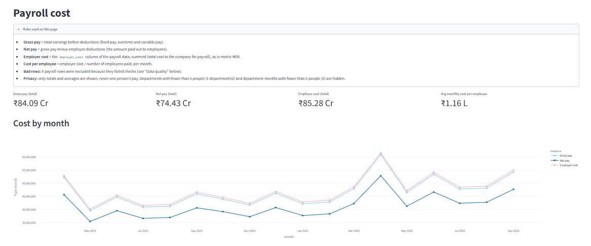
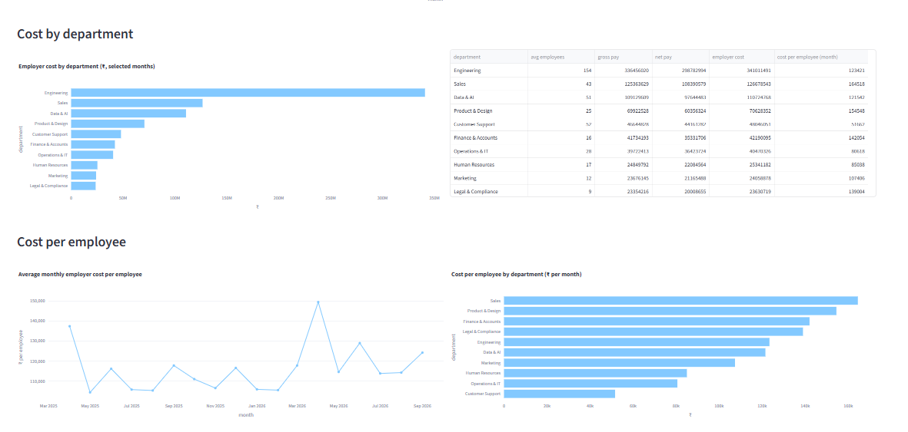
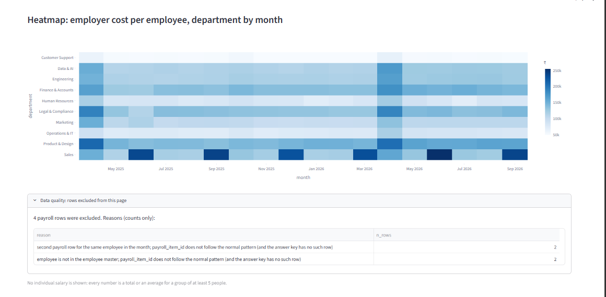
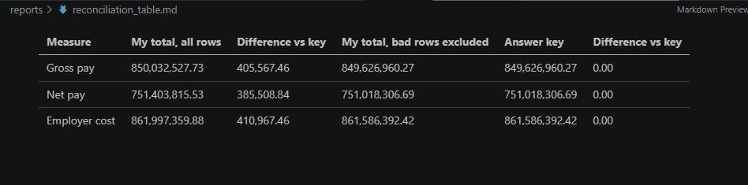

# Task 9: Payroll cost and reconciliation

**Page:** `pages/5_Payroll_Cost.py` (part of the PulseIQ dashboard)
**Data:** `fact_payroll` (7,344 rows, Apr 2025 to Sep 2026, 11 departments), `dim_department`
**Answer key:** `unlock_PQ-09` (18 months of payroll gross, net, employer cost and employees paid)
**Views:** `dw.v_payroll_good`, `dw.v_payroll_dept_month`, `dw.v_payroll_dept_size`, `dw.v_payroll_company_month` (see `sql/payroll_views.sql`)

## Screenshots

## Reconciliation table (company totals, all departments, 18 months)

| Measure | My total, all rows | Difference vs key | My total, 4 bad rows excluded | Answer key | Difference vs key |
|---|---|---|---|---|---|
| Gross pay | 850,032,527.73 | +405,567.46 | 849,626,960.27 | 849,626,960.27 | 0.00 |
| Net pay | 751,403,815.53 | +385,508.84 | 751,018,306.69 | 751,018,306.69 | 0.00 |
| Employer cost | 861,997,359.88 | +410,967.46 | 861,586,392.42 | 861,586,392.42 | 0.00 |

Month by month, 14 of 18 months matched the key from the start. 4 months (May 2025, Dec 2025, Feb 2026 and Apr 2026) were too high for gross, net, employer cost and, in two of them, the number of employees paid. After excluding 4 rows, all 18 months match.

## How I reconciled

1. I built the page from all rows in `fact_payroll` and compared monthly totals with the answer key.
2. 4 months were too high in all three measures. Each difference equalled the amounts of exactly one payroll row, so I looked for rows with those amounts in those months.
3. In each month, two rows matched the amounts. I used evidence in the data to choose the bad one (see the excluded rows).
4. I excluded the 4 rows (`dw.payroll_excluded`) and re-ran the comparison: all 18 months match on gross, net, employer cost and employees paid.

## Excluded rows (details in `reports/excluded_rows.md`)

4 rows, all with a payroll_item_id that does not follow the normal `PI-` plus numbers pattern (the only 4 such IDs in the table): two are a second payroll row for the same employee in the month, and two belong to an employee who is not in the employee master. Together they overstated employer cost by about 0.05%.

## Privacy

Only totals and averages are shown. Departments with fewer than 5 people (and department-months with fewer than 5 people) are hidden, so the page total is slightly lower than the company total in the table above. No employee ID or individual pay appears on the page or in this report.

## Limits

- For the two duplicates, the original and the duplicate have identical amounts, so the totals cannot show which is the extra one. I chose the row with the unusual ID. The cost total is the same either way.
- My Task 4 metric views (M07 to M10) read `fact_payroll` directly, so they still include the 4 bad rows. The Task 9 page uses the cleaned view `v_payroll_good`.
- The key's total is a reference, not proof of the cause. For the 4 rows I give the reasons the data supports and ask finance to confirm.
- The data is synthetic.