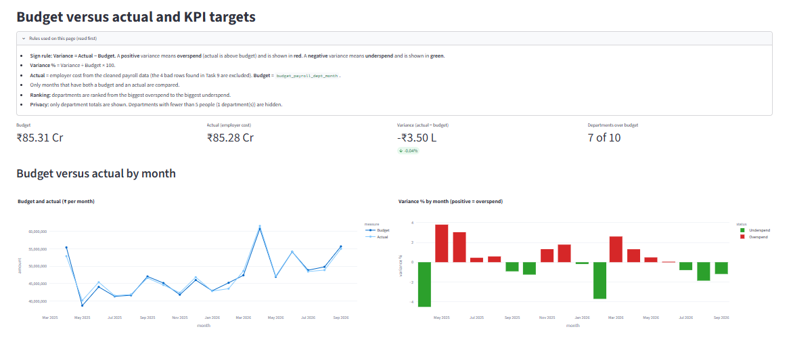
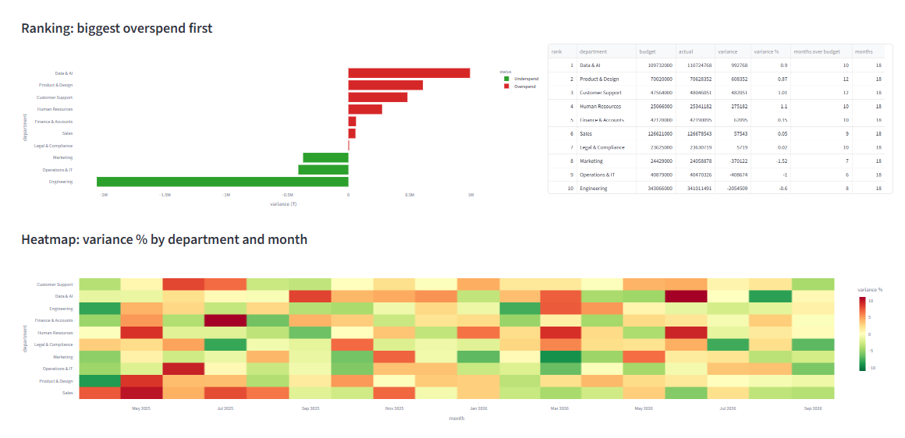
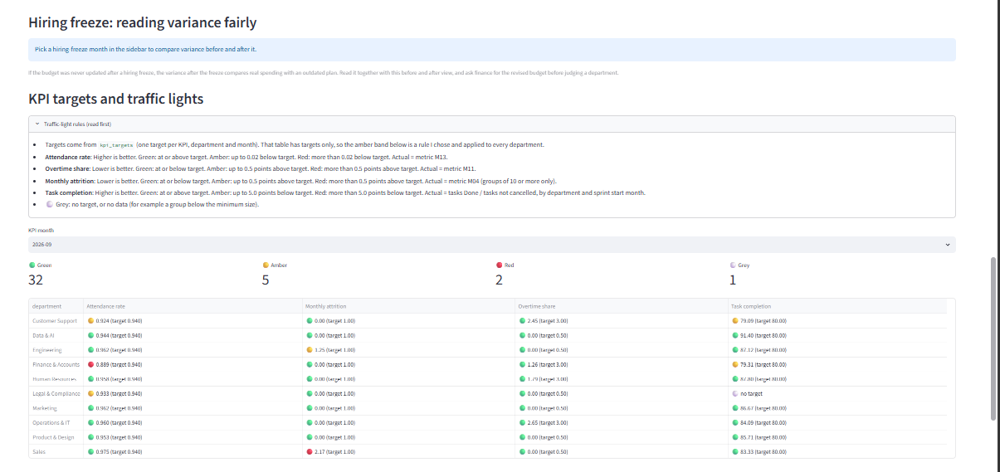
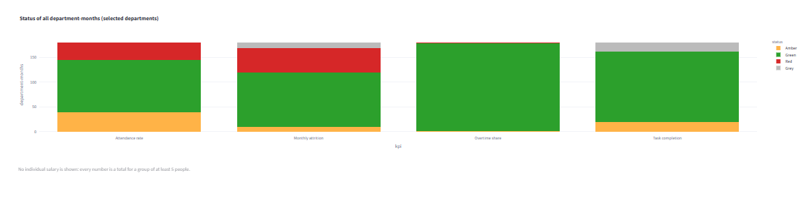
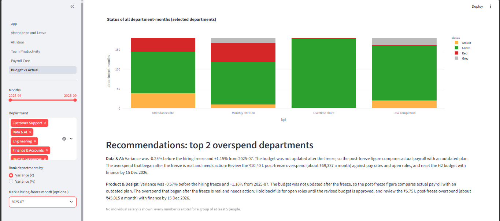

| KPI | department-months | status differs from by-hand | match |
|---|---|---|---|
| Attendance rate | 180 | 0 | YES |
| Overtime share | 180 | 0 | YES |
| Monthly attrition | 180 | 0 | YES |
| Task completion | 180 | not rechecked here | check 2 cases by hand |

| KPI | department_id | month | actual | target | status in view | by hand |
|---|---|---|---|---|---|---|
| Attendance rate | D02 | 2025-05 | 0.9172 | 0.94 | Red | Red |
| Attendance rate | D01 | 2025-05 | 0.935 | 0.94 | Amber | Amber |
| Attendance rate | D01 | 2025-04 | 0.9509 | 0.94 | Green | Green |
| Overtime share | D06 | 2025-11 | 3.55 | 3.0 | Red | Red |
| Overtime share | D06 | 2025-07 | 3.25 | 3.0 | Amber | Amber |
| Overtime share | D01 | 2025-04 | 0.0 | 0.5 | Green | Green |
| Monthly attrition | D01 | 2025-04 | 2.1 | 1.0 | Red | Red |
| Monthly attrition | D01 | 2025-05 | 1.41 | 1.0 | Amber | Amber |
| Monthly attrition | D01 | 2025-12 | 0.67 | 1.0 | Green | Green |

| Department | Month | Budget | Actual | Variance | Variance % | Page shows | Match |
|---|---|---|---|---|---|---|---|
| Engineering | 2025-08 | 16,501,000 | 16,923,386.93 | +422,386.93 | +2.56% | +2.56% | Yes |
| Sales | 2025-08 | 4,445,000 | 4,727,511.08 | +282,511.08 | +6.36% | +6.36% | Yes |
| Finance & Accounts | 2025-08 | 2,481,000 | 2,326,125.16 | −154,874.84 | −6.24% | −6.24% | Yes |

All three values were recalculated by hand with a calculator and match the page. A positive variance means overspend.

| Department | Month | Target | Actual | Shortfall (points) | Band rule | Status (page) | Status (by hand) | Match |
|---|---|---|---|---|---|---|---|---|
| Operations & IT | 2025-11 | 80.00 | 70.64 | 9.36 | More than 5.0 below target | Red | Red | Yes |
| Customer Support | 2025-04 | 80.00 | 79.75 | 0.25 | Up to 5.0 below target | Amber | Amber | Yes |

