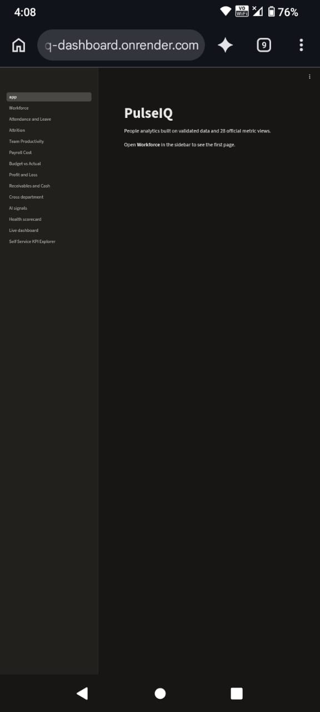

# Task 18: Dashboard and Self-Service KPI Explorer

A multi-page Streamlit dashboard on the PulseIQ warehouse. Task 18 is the self-service KPI explorer (page 13). Pages 1 to 12 are the Phase 2 and Phase 3 dashboards, deployed in the same app.

**Live dashboard:** https://pulseiq-dashboard.onrender.com 

The free Render plan sleeps when idle. The first visit can take up to 60 seconds.

## Task 18: Self-Service KPI Explorer (page 13)

`pages/13_Self_Service_KPI_Explorer.py` lets a user:

- Choose a metric and a grouping dimension.
- Drill down from company to department to team.
- See small groups suppressed: groups with fewer than 5 people are not shown.

[Confirm each point on the live page before submitting. Remove any point that does not work.]

## Privacy rule

Groups with fewer than 5 people are hidden. Page 5 (Payroll Cost) applies this to department-month rows and shows the number of rows hidden. Page 13 applies the same minimum group size. [Confirm page 13 does this.]

## Dashboard pages

| # | Page | Phase |
|---|---|---|
| 1 | Workforce | 2 |
| 2 | Attendance and Leave | 2 |
| 3 | Attrition | 2 |
| 4 | Team Productivity | 2 |
| 5 | Payroll Cost | 3 |
| 6 | Budget vs Actual | 3 |
| 7 | Profit and Loss | 3 |
| 8 | Receivables and Cash | 3 |
| 9 | Cross-Department Impact | 3 |
| 10 | AI Signals and Anomalies | 3 |
| 11 | Health Scorecard | 3 |
| 12 | Live Dashboard | 4 |
| 13 | Self-Service KPI Explorer | 4 (Task 18) |

## Screenshot

Phone test of the live dashboard:



## Files

- `app.py`: Streamlit entry point.
- `db.py`: opens `pulseiq.duckdb` in this folder.
- `pages/`: one file per dashboard page.
- `docs/screenshots/`: test screenshots.

The `pulseiq.duckdb` file must be in this folder. The root `pulseiq.duckdb` is used by the API in Task 19, not by this app.

## Run locally

From the repo root, with the virtual environment active:

```bash
pip install -r requirements.txt
cd phase-4\task18
streamlit run app.py
```

Open http://localhost:8501.

## Requirements

Installed from the root `requirements.txt`, which includes `streamlit`, `pandas`, `plotly`, `duckdb` and `openpyxl`. Pages 9 to 13 need `openpyxl`.

## Known limits

- Scheduled refresh is not running. Data is from 21 October 2026.
- The app is hosted on Render's free plan, so it sleeps when idle.
- Page 13's team drill-down [confirm it works; remove this line if it does].