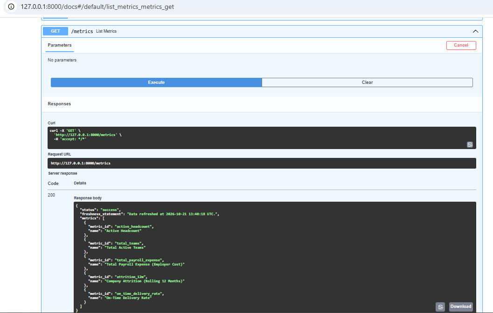
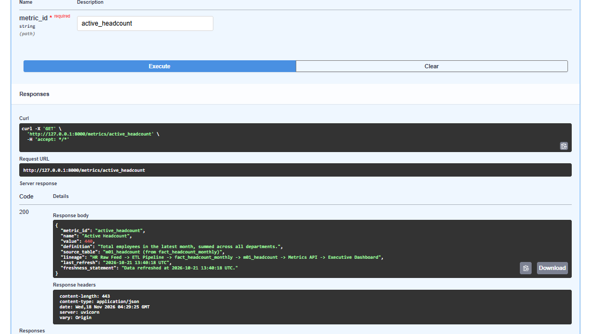
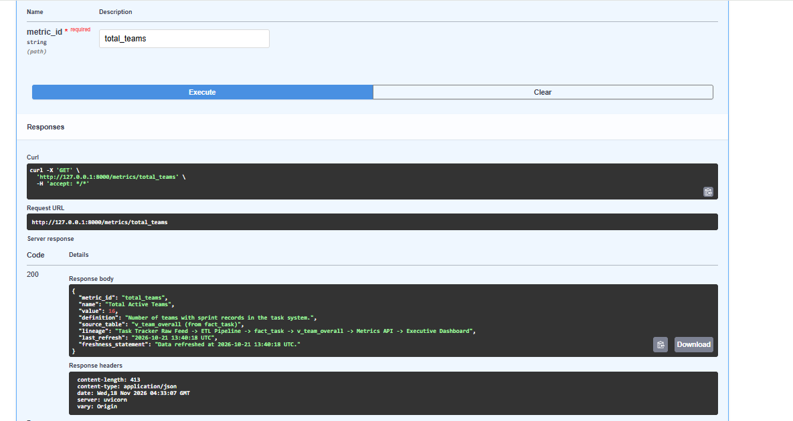
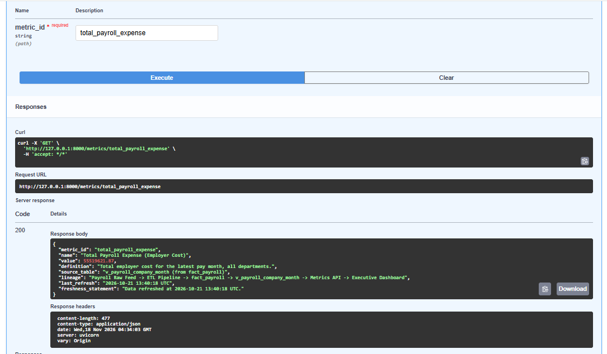
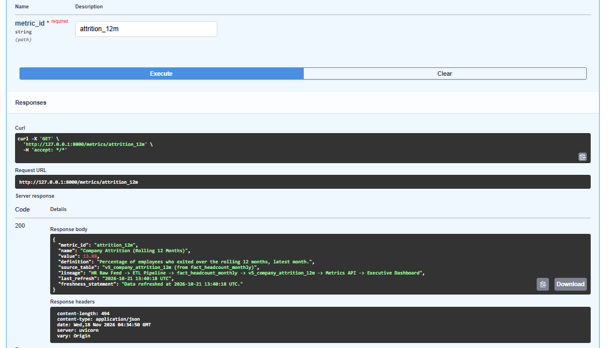
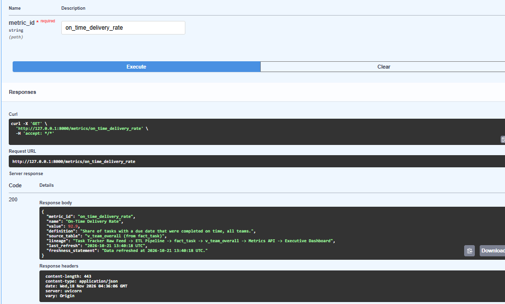

# PulseIQ Metrics API

A small read-only API that returns five trusted company metrics. Each response includes the value, its definition, the source table, the lineage from raw feed to dashboard, and when the data was last refreshed.

Base URL (local): `http://127.0.0.1:8000`
Base URL (deployed): `https://YOUR-APP.onrender.com` (add after deployment)

Interactive docs: `/docs`

## Endpoints

| Method | Path | Description |
|---|---|---|
| GET | `/` | Service name and link to docs |
| GET | `/health` | Service check |
| GET | `/metrics` | List all metrics with freshness statement |
| GET | `/metrics/{metric_id}` | One metric: value, definition, source, lineage, refresh time |

## Metric IDs

| metric_id | Name |
|---|---|
| `active_headcount` | Active Headcount |
| `total_teams` | Total Active Teams |
| `total_payroll_expense` | Total Payroll Expense (Employer Cost) |
| `attrition_12m` | Company Attrition (Rolling 12 Months) |
| `on_time_delivery_rate` | On-Time Delivery Rate |

## Examples

### List metrics

```bash
curl http://127.0.0.1:8000/metrics
```

### Get one metric

```bash
curl http://127.0.0.1:8000/metrics/active_headcount
```

Response:

```json
{
  "metric_id": "active_headcount",
  "name": "Active Headcount",
  "value": 460,
  "definition": "Total employees in the latest month, summed across all departments.",
  "source_table": "m01_headcount (from fact_headcount_monthly)",
  "lineage": "HR Raw Feed -> ETL Pipeline -> fact_headcount_monthly -> m01_headcount -> Metrics API -> Executive Dashboard",
  "last_refresh": "2026-10-21 13:40:18 UTC",
  "freshness_statement": "Data refreshed at 2026-10-21 13:40:18 UTC."
}
```

### Other metrics

```bash
curl http://127.0.0.1:8000/metrics/total_teams
curl http://127.0.0.1:8000/metrics/total_payroll_expense
curl http://127.0.0.1:8000/metrics/attrition_12m
curl http://127.0.0.1:8000/metrics/on_time_delivery_rate
```

Sample values from the test run:

| metric_id | value |
|---|---|
| active_headcount | 440 |
| total_teams | 16 |
| total_payroll_expense | 55519621.87 |
| attrition_12m | 13.88 |
| on_time_delivery_rate | 92.9 |

## Errors

| Status | Meaning |
|---|---|
| 404 | Unknown `metric_id` |
| 500 | The query against the warehouse failed. The `detail` field explains why. |

## Freshness

Every response includes `last_refresh` and `freshness_statement`. Check these before using a value. The test run reports a last refresh of 2026-10-21, which is older than the current date, so the values may be stale.

## Evidence

Each screenshot shows the endpoint returning 200 with the Request URL visible.

### Metric list



### Metric details







### Phone test (live URL)

